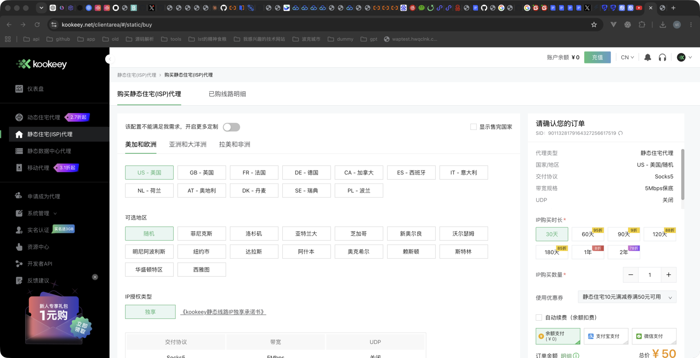
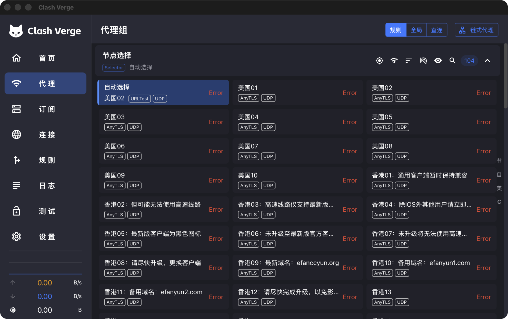
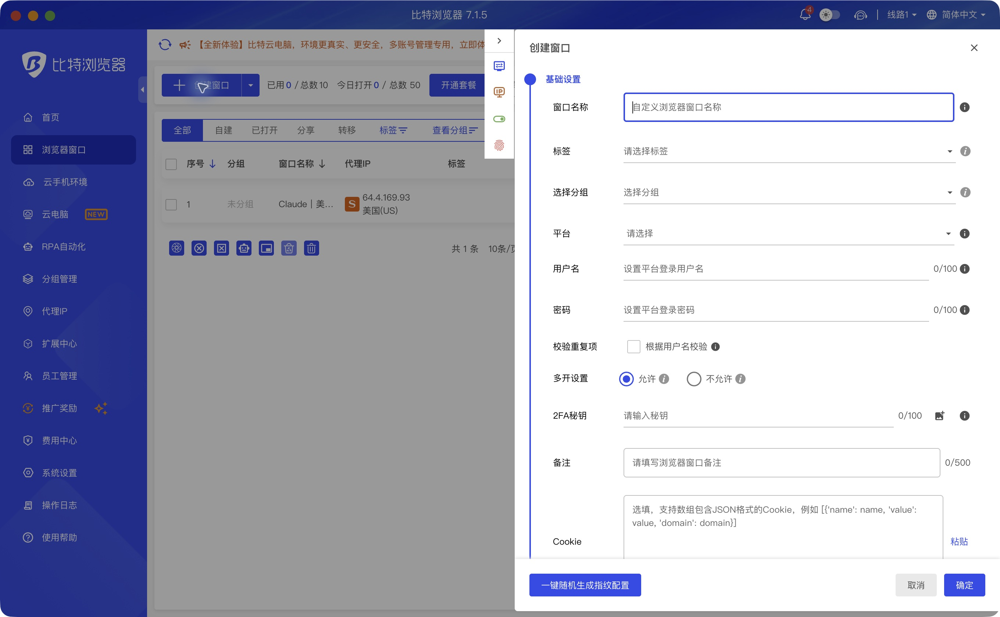
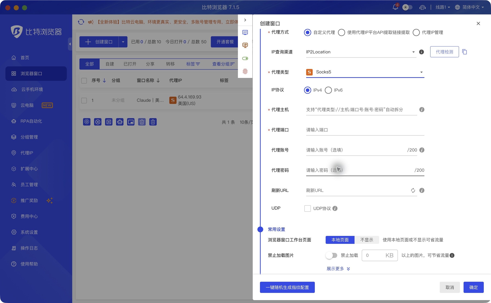
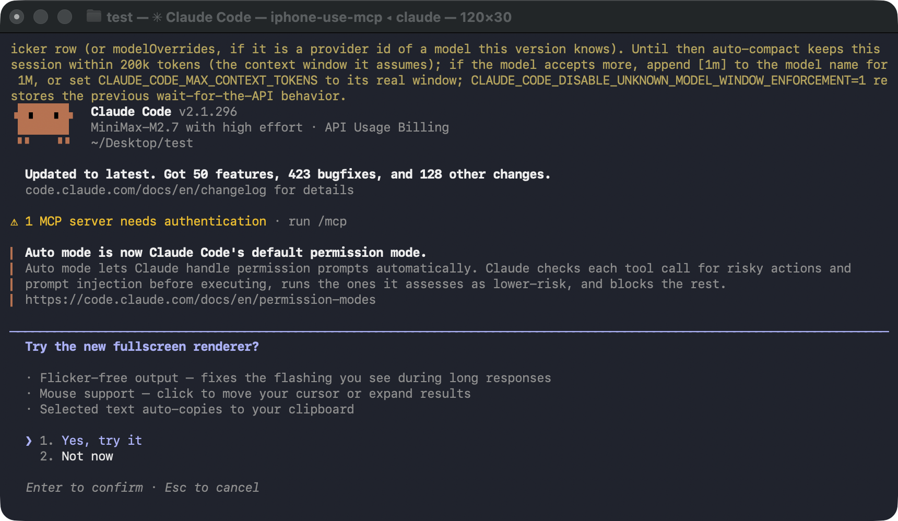
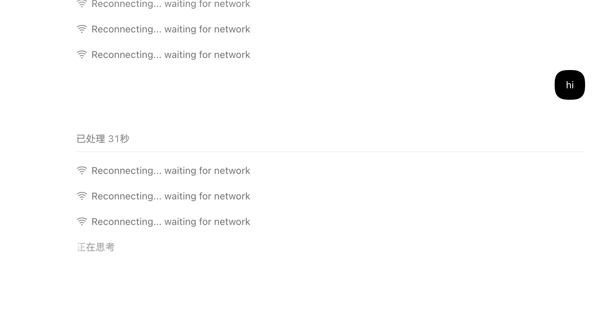

# Claude 环境：跟着真实界面配置

更新：2026-10-11 · 主流程适用于 macOS。Windows 附有安装及端口检查差异，尚未实机验收。图片可点开查看原尺寸。

**新电脑从第 0 步开始；已有环境从第 1 步核对。** 不依赖旧电脑桌面路径、固定端口、环境序号或已登录状态。迁移 Skill 不会迁移账号、代理订阅或浏览器登录。

[离线图文页面](guide.html) · [安装到另一台电脑](install.md) · [排障](troubleshooting.md) · [图片来源](../assets/ui/sources.json)

## 0. 新电脑先准备这些

| 准备项 | 在哪里取得 | 看到什么才算完成 |
|---|---|---|
| Clash Verge Rev | [项目官方发布页](https://github.com/clash-verge-rev/clash-verge-rev/releases)；按系统和 CPU 选包 | 应用能启动，Mihomo 核心正常运行 |
| 可用前置网络 | 用户自己的已有服务；在 Clash 的“订阅”导入该服务的链接/配置 | 选一个前置节点，实际访问海外网站成功 |
| kookeey 线路 | [用户指定入口](https://www.kookeey.net/clientarea/#/static/list)；先看已有订单 | 有效线路及其服务器、端口、认证参数 |
| BitBrowser | [官网下载](https://www.bitbrowser.net/download)，按系统选版本 | 可进入“浏览器窗口”列表 |
| 邮箱和 Claude 账号 | 使用自己的目标账号；[官方服务支持条件](https://www.anthropic.com/supported-countries) | 能收验证邮件，Claude 账号具备目标服务权限 |
| Claude Code | [官方安装说明](https://code.claude.com/docs/en/setup) | 新终端运行 `claude --version` 有版本号 |
| 本 Skill | [本包安装说明](install.md) | 新会话能调用 Skill，图片和参考文件完整 |

住宅代理不等于可用前置。免费 Claude 网页账号也不等于具有 Claude Code 订阅权限。以上均需自己的授权和有效服务；Skill 不提供账号、线路或服务资格。

macOS 的 Claude Code 官方原生安装命令如下；已有安装先核对入口，避免重复装多份：

```bash
curl -fsSL https://claude.ai/install.sh | bash
```

装好后重开终端，再运行 `claude --version`。若找不到命令，按官方 PATH 排障页修复；不要照抄别人的用户名路径。Python 检查脚本需要 Python 3.9+，没有 Python 仍可按图手动检查。

## 1. 先填自己的参数表

这张表在当前机器填写，包含认证的部分只存本机私有位置。不要把填写后的表提交 Git。

| 参数 | 从哪里读 | 本机要记录什么 |
|---|---|---|
| 系统 / CPU | 系统信息 | macOS/Windows，Apple Silicon/x64 |
| 前置组 `Front` | Clash → 代理；实际可连的节点/组 | 完整名称；示例 Front 需替换 |
| 住宅参数 | kookeey → 已购线路明细 | 协议、服务器、端口、账号、密码、UDP、到期 |
| Mac 普通代理端口 `P` | Clash → 设置 → 端口；再查监听者 | 当前可用端口，例如 7897，只是例子 |
| 浏览器专用 SOCKS 端口 `B` | 下方第 3 步创建的 listener | 当前可用且不同于 P 的端口，例如 7898 |
| BitBrowser 环境 | 浏览器窗口列表 | 新建或迁移的目标环境；编号可能不同 |
| Claude 登录目标 | 自己的账号页面 | 目标账号和订阅/API 方式，别记录密码 |

**已有电脑：** 复用已经成功的专用环境，保留 Cookie、指纹和代理状态。**全新电脑：** 先检查同账号下是否已有同步环境；有则核对权限后复用，没有才创建一个专用窗口。环境序号 1 只是历史实例。

## 2. kookeey：先看已有线路，再决定买不买



**这张是你之前发的真实界面。** 图内默认选“随机”，并不表示应购买随机地区；历史价格不作为当前报价。

1. 打开 [静态线路页面](https://www.kookeey.net/clientarea/#/static/list)，登录自己的账号，先点 **已购线路明细**。
2. 已有有效线路：核对 **代理状态、剩余时间、协议、服务器地址、端口号、账号/密码、出口 IP**。这些字段对应后续客户端配置，不需要重复购买。
3. 没有有效线路且确有需求：点 **购买静态住宅(ISP)代理**，选择自己的目标国家与城市；别跳过“随机/指定城市”的区别。
4. 核对 SOCKS5 等协议、带宽、UDP、时长、数量、总价、自动续费。只有明确确认具体订单后才付款。
5. 开通后回到 **已购线路明细**，等状态正常，再把当前参数填入本机私有配置。

**预期结果：** 线路存在且有效，能取得当前参数。付款按钮或订单页截图不能证明代理能连接。含明文密码的已购线路原图没有打包进本 Skill。

## 3. Clash：先前置，再住宅，再分流



**在哪里看：** 左侧 **订阅** 导入自己的前置服务；左侧 **代理** 查看节点；右上选 **规则**。这张原图说明“节点已经显示出来”仍可能全部不可用。

1. 备份当前订阅、扩展和设置。先只用前置做一次真实访问，成功后再接住宅。
2. 在当前订阅支持的扩展/覆写机制里加入住宅节点。服务器、端口、认证必须来自当前 kookeey 线路。`dialer-proxy` 填真实存在的前置节点或组，不能填住宅自己。
3. 加入 `ClaudeExit` 组选择住宅节点；目标域名规则放在国内规则及 MATCH 前。
4. 给 BitBrowser 建一个只监听 `127.0.0.1` 的独立 SOCKS 入口，固定指向 `ClaudeExit`。只改系统 mixed-port 不会自动生成专用入口。
5. 客户端校验配置并重载，确认核心继续运行、P/B 端口监听正常。校验失败则恢复备份，不清空整个订阅重来。

下面是**合并片段**，不是完整订阅。已有 `proxies` / `proxy-groups` / `listeners` / `rules` 时合并到对应列表，不能重复顶层键。`Front` 必须换成现有可用前置；7898 必须换成你的 B。GUI 的扩展形式因版本不同而异，由 Agent 先读取当前格式再合并，不直接覆盖供应商文件。

```yaml
proxies:
  - name: Residential
    type: socks5
    server: proxy.example.invalid
    port: 10000
    username: FILL_PRIVATELY
    password: FILL_PRIVATELY
    udp: false
    dialer-proxy: Front
proxy-groups:
  - name: ClaudeExit
    type: select
    proxies: [Residential]
listeners:
  - name: claude-browser
    type: socks
    listen: 127.0.0.1
    port: 7898
    udp: false
    proxy: ClaudeExit
rules:
  - DOMAIN-SUFFIX,claude.ai,ClaudeExit
  - DOMAIN-SUFFIX,claude.com,ClaudeExit
  - DOMAIN-SUFFIX,anthropic.com,ClaudeExit
  # 此后保留你原有的国内白名单 DIRECT 规则
  # 最后保留或调整 MATCH 到实际前置组
```

国内规则集需要用户当前配置中的真实 rule-provider，不能照抄不存在的名字。认证域名可能变化：根据目标请求连接日志补齐。Mac 可使用 TUN 接管；也可使用系统/应用显式代理。开关位置和系统授权依版本而异。

**预期结果：** 目标请求的连接日志显示住宅经指定前置；国内请求命中 DIRECT；其他海外请求命中前置。只看到 TUN 开启或测速数字还不够。

依据：[Mihomo dialer-proxy](https://wiki.metacubex.one/config/proxies/dialer-proxy/) · [listener 固定出站](https://wiki.metacubex.one/config/inbound/listeners/) · [SOCKS listener](https://wiki.metacubex.one/config/inbound/listeners/socks/) · [规则](https://wiki.metacubex.one/config/rules/)。

## 4. BitBrowser：每个字段填什么



**入口：** 左侧 **浏览器窗口** → 先找已有目标环境；全新环境才点 **创建窗口** → **基础设置**。窗口名称用容易识别的名字，例如“Claude 专用”。平台用户名、平台密码、2FA、Cookie 不需要为了建立网络而填写。



**接第 3 步的本地专用入口时：**

| UI 字段 | 填什么 | 为什么 |
|---|---|---|
| 代理方式 | 自定义代理 | 使用自己的本地入口 |
| 代理类型 | Socks5 | 对应 listener 的 type: socks |
| 代理主机 | `127.0.0.1` | 当前这台电脑的 Clash；不能填旧电脑地址 |
| 代理端口 | 本机 B | 必须已经监听并固定到住宅 |
| 代理账号 / 密码 | 默认留空 | 本例本地入口未单独配置认证；若现有入口要求认证则使用其参数 |
| UDP | 按整条链路实际支持情况 | 本例住宅不支持时关闭 |
| 代理检测 | 字段完成后点击 | 检查当前入口可用；再用窗口内真实请求复验 |

不要把 kookeey 的账号密码填到无认证的本地入口；直接连接供应商则是另一条路径，需要服务器及认证，并且须确认当前网络能到达该服务器。

新建时检查语言、时区、WebRTC 和定位等隐私设置是否符合自己的需求。已有环境不要反复随机指纹或清 Cookie。图里背景的环境名、出口和软件版本只是历史示例。

**预期结果：** 保存并打开目标窗口，在窗口内访问 `https://ipinfo.io/json`，返回当前住宅出口；然后访问 Claude 并完成真实回复。只看供应商 IP 的搜索结果不算验证当前出口。

## 5. Claude 网页与 CLI：两处都验收

收信、验证链接、网页登录和 CLI OAuth 使用同一个已确认的专用窗口。验证码、密码和一次性授权码由用户处理，不放入教程、截图或 Git。



1. 网页先确认正确账号、套餐页面及一次真实回复。历史截图中的套餐或模型名不作为今天的服务状态。
2. 新终端运行 `type -a claude`、`claude --version`、`claude auth status`。Windows 用 `Get-Command claude -All` 查看入口。
3. 首次运行 `claude`，按当前官方登录流程生成授权 URL；自动打开了其他浏览器时，把本次完整 URL 在目标专用窗口中打开。不要复制旧会话的链接。
4. 若 OAuth 后仍显示 MiniMax，先备份设置，按目标处理旧 `ANTHROPIC_*` provider/模型覆盖；设置、进程环境与旧 CLI 进程分别检查。不要整体删除设置或认证。
5. 新进程发一次最小请求。先查 `claude --help`，确认当前版本支持下面选项；不支持时依据当前官方 CLI 文档使用等效限制。

```bash
claude -p 'Reply exactly OK' \
  --safe-mode --tools '' --strict-mcp-config \
  --no-session-persistence --max-turns 1 --output-format json
```

**预期结果：** 正确入口、目标认证方式/provider、一次真实成功响应。认证命令可能含账号信息，只在本机查看，不原样提交日志。钥匙串受限是“未能检查”，不能直接认定已登出。



反复重连时，回查当前进程实际用的端口、对应监听者和目标域名链路。恢复一个入口后，要分别复验网页与 CLI。

## 6. iPhone 是可选的另一条链路

本包暂未收录可安全发布的本人手机 UI 原图；下面明确为示意，不能当手机实测证据。


在 Shadowrocket 中先检查已有住宅节点。新增时使用当前供应商 SOCKS5 参数，“代理通过”选择可用前置；保存、选中住宅节点并启用 VPN。在 Safari 访问 `https://ipinfo.io/json` 和 `https://claude.ai/cdn-cgi/trace`，读取服务端当前响应。

Mac 国内白名单不会自动同步手机。需要 AI 控制手机还需单独安装/验收 iPhone Use、Xcode、签名、开发者模式和 USB 通道；识别设备不等于能完成点击。

## 7. 迁移到另一台电脑

1. 按 [安装说明](install.md) 获取完整 Skill，包括 assets、references、scripts，不能只复制 SKILL.md。
2. 新机按第 0 步安装软件；用第 1 步重新采集参数。旧机 `127.0.0.1:B` 只能指向旧机自己，复制到新机前必须先在新机建立该入口。
3. 通过服务商正常登录/自己的私有备份迁移订阅；不要通过 Git 迁移密码、Cookie、Token、OAuth URL 或钥匙串文件。
4. BitBrowser 同步环境也需要本机可用代理。确认既有环境和同步授权，保留原环境；不要假定所有登录已随 Skill 搬过来。
5. 重新完成下面验收表。旧电脑的成功记录不能代替新机结果。

### Windows 的差异

官方安装可在 PowerShell 运行 `irm https://claude.ai/install.ps1 | iex`，完成后重开 PowerShell。Skill 的通用图文与字段映射可复用；Clash 安装包、服务安装、TUN 授权、路径及进程检查需按 Windows 处理。WSL 是独立网络/文件环境，不能直接假定它的 loopback 就是 Windows 的代理入口。

本包检查脚本明确只支持 macOS/Linux 的自动检查，Windows 运行会报告不支持并退出。Windows 手动检查自己的实际端口，例如：

```powershell
Get-Command claude -All
claude --version
Get-NetTCPConnection -State Listen -LocalPort 7897,7898 |
  Select-Object LocalAddress,LocalPort,OwningProcess
```

7897/7898 替换为当前 P/B。这些 Windows 步骤来自官方说明与系统命令，未在 Windows 真机上跑过。

## 8. 最后按这张表验收

| 环节 | 需要看到的结果 | 没做时怎么记录 |
|---|---|---|
| 配置 | 核心校验成功；重载后仍正常 | 未验证配置 |
| Mac 分流 | 国内 DIRECT、目标住宅链、海外前置的真实请求及日志 | 未验证实际路由 |
| BitBrowser | 目标窗口当前出口符合预期，Claude 真实回复 | 未验证浏览器 |
| 邮箱 | 能进入收件箱并收所需邮件 | 未验证收信 |
| Claude Code | 目标 provider/认证及新进程真实回复 | 未验证模型调用 |
| iPhone（需要时） | Safari 当前出口与真机操作成功 | 未验证手机 |
| 重启/故障（需要时） | 各场景独立测试成功 | 未验证恢复或断线保护 |

可选运行 `python3 scripts/inspect_environment.py --ports P B`（先将 P/B 换成数字）。不传 --ports 时不检查任何历史默认端口。脚本只读、只输出过滤后的状态；运行成功也不能代替真实网络和模型验收。

## 图片与证据范围

本版包含 4 张旧会话用户原图和 2 张本次补拍的空白表单；没有修改图片像素。全部 Error、MiniMax、Reconnecting 都标为失败案例。购买页只是界面参考；新表单查看后已取消，没有创建新窗口，也没有付款或改变网络配置。

[来源清单](../assets/ui/sources.json) 记录日期、用途及 SHA256；不打包原始会话、密码截图或私人聊天。旧版示意图仍留作概念补充，不能当实际产品截图。新电脑与 Windows 的端到端配置尚未实机验证。
