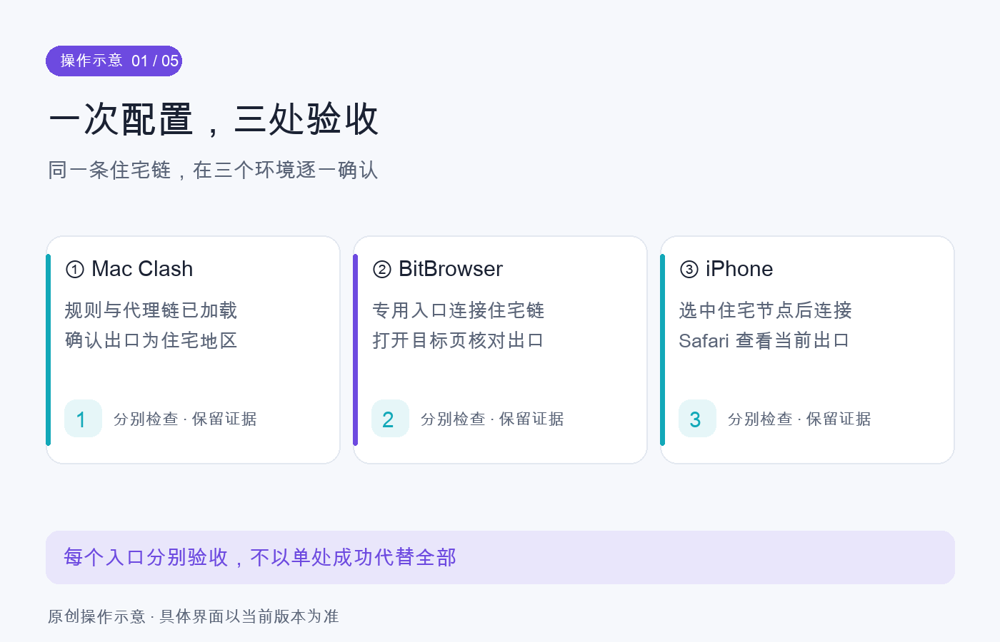
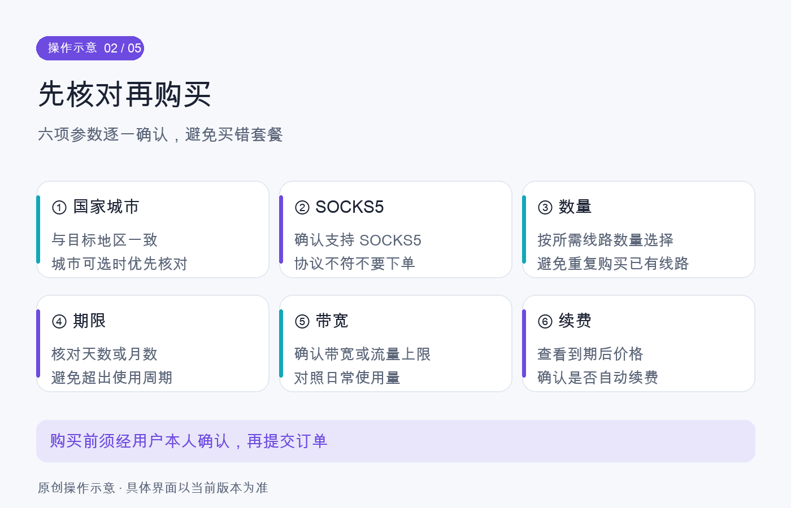
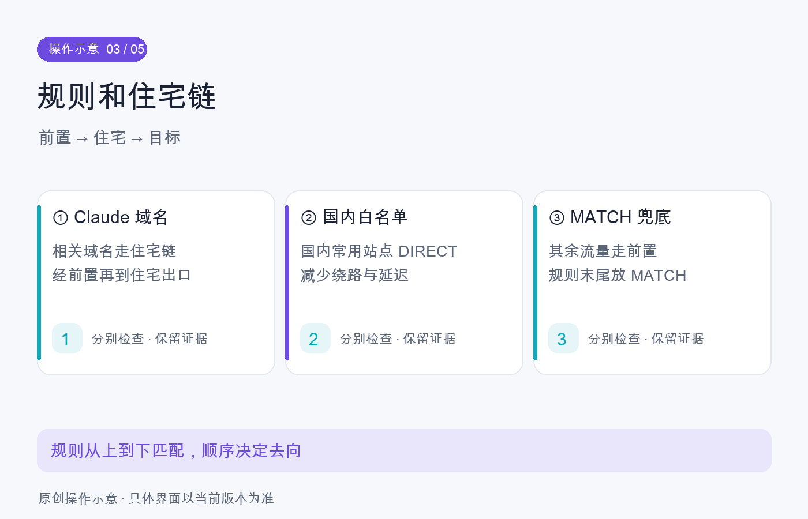
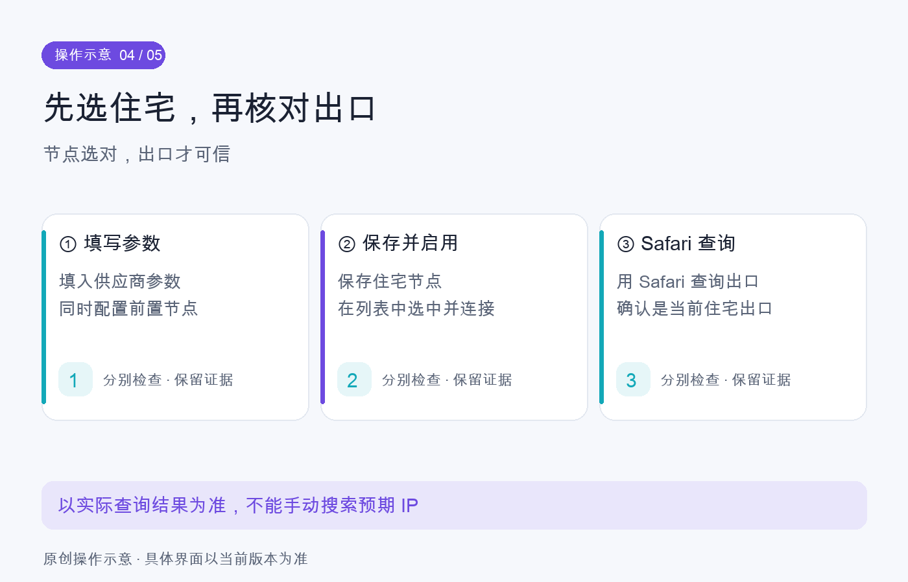
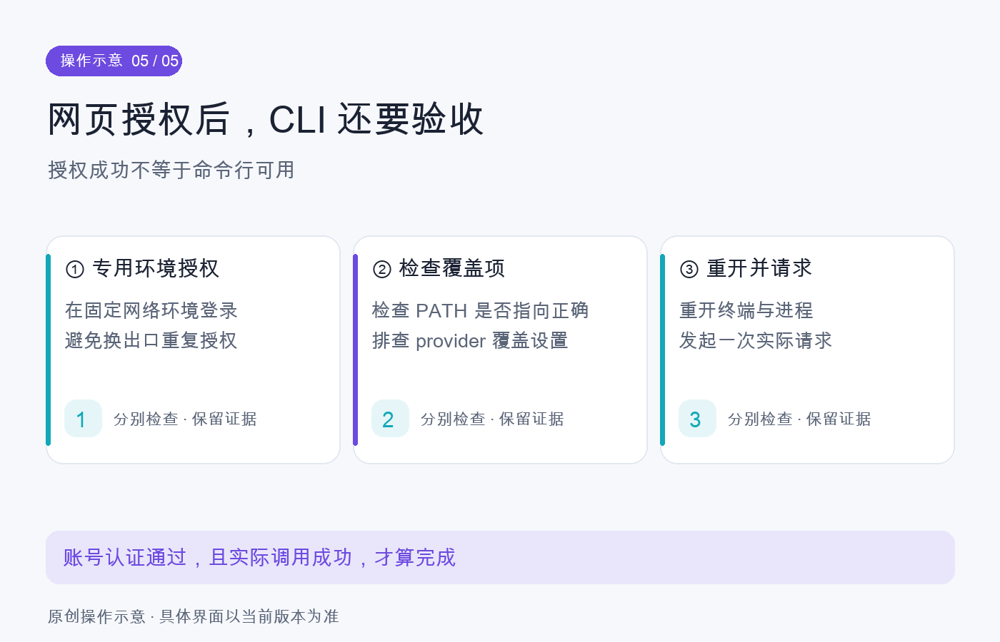

# 图文操作指南

更新时间：2026-10-11。面向 macOS、Clash Verge / Mihomo、BitBrowser、可选 iPhone Shadowrocket 和 Claude Code。来自本项目已执行流程的可复用提炼；图为原创操作示意，未连接用户账号，也不表示已经在当前设备执行。

## 1. 先认清三个入口



Mac 域名分流、BitBrowser 整个专用窗口和 iPhone VPN 是三个入口。Mac 配好了，不代表另外两个自动同步。

| 入口 | 作用 | 先检查 |
|---|---|---|
| Mac Clash | 国内白名单直连、目标走住宅、其他海外走前置 | 核心、监听端口、TUN/显式代理、连接日志 |
| BitBrowser | 专用窗口内收信、验证和 OAuth | 复用已有环境、代理端口、窗口实际出口 |
| iPhone | 手机 App 与 Safari 访问 | Shadowrocket 节点、代理通过、VPN 与当前出口 |

单次配置核验不等于长期稳定。整个链路需要可用前置，住宅本身不一定能从当前网络直连。

## 2. 在 kookeey 购买或复用线路



固定入口：[kookeey 静态住宅线路](https://www.kookeey.net/clientarea/#/static/list)。登录后先看已有线路，避免重复购买。如果需要购买，从当前页面提供的购买入口继续，按钮名称以实际 UI 为准。

| 项目 | 核对方式 |
|---|---|
| 类型 | 静态住宅 / ISP；不能仅凭节点名称认定独享或固定 |
| 国家/城市 | 按用户目标选择；本项目历史示例是美国洛杉矶 |
| 协议 | 客户端可用的协议，本指南以 SOCKS5 为例 |
| 带宽、时长、数量 | 按实际需求核对；历史参考为 5Mbps / 30天 / 1条 |
| 前置与 UDP | 核对是否需要前置、线路是否支持 UDP；不支持时关闭 |
| 总价与续费 | 以最终订单为准；明确是否自动续费，不沿用历史报价 |

先让用户确认具体订单再付款。开通后，在受限位置私密保存服务器、端口、认证、当前出口和到期时间。普通笔记只保留不含凭据的摘要；不要把供应商访问密钥或节点导入 URL 放进 Git。

本项目采用过“首月住宅、以后普通美国节点”的预算方案；到期不会自动切换，且没有证据说明用满一个月会得到防封保证。

## 3. 配置 Clash 的分流和链式代理



先备份现有订阅和扩展，再识别可用前置。住宅节点通过 `dialer-proxy` 指向前置节点或组；名称必须完全一致，且不能指向自己。

规则顺序：目标域名 → 国内域名/IP → MATCH 海外兜底。保持规则模式，不用全局模式代替这套分流。

下面是逻辑片段，不能直接当完整配置导入。占位值必须在本机私有配置内替换，不要把填写后的版本提交仓库：

```yaml
proxies:
  - name: Residential
    type: socks5
    server: proxy.example.invalid
    port: 10000
    username: FILL_PRIVATELY
    password: FILL_PRIVATELY
    udp: false
    dialer-proxy: Front
# Front 必须是已存在且可用的前置节点/组
# 规则集及对应代理组需要根据实际配置补齐
rules:
  - DOMAIN-SUFFIX,claude.ai,ClaudeExit
  - DOMAIN-SUFFIX,claude.com,ClaudeExit
  - DOMAIN-SUFFIX,anthropic.com,ClaudeExit
  - RULE-SET,DomesticDomains,DIRECT
  - RULE-SET,DomesticIPs,DIRECT
  - MATCH,Front
```

使用客户端当前支持的国内规则集，核对 rule-provider 名称、行为与下载状态。不要直接覆盖整个订阅，导致原节点、DNS 或客户端扩展丢失。认证域名可能变化，应结合当前连接日志补齐。

### 端口迁移

先看端口归属：

```bash
lsof -nP -iTCP:7897 -sTCP:LISTEN
lsof -nP -iTCP:7898 -sTCP:LISTEN
scutil --proxy
```

数字是历史示例。如果 Clash 临时换了端口，应用仍可能指向旧端口；TUN 不会自动修正所有显式代理地址。验证新核心的实际请求，再由用户完成可能让当前聊天断线的旧客户端退出。

### 验收

在实际接管后请求 `https://claude.ai/cdn-cgi/trace`，同时检查 Clash 日志中的命中组与链路。若普通 IPinfo 走海外默认组，它只能验证该默认组，不能验证 Claude 专用住宅路径。

节点名称不是出口证据。TUN 开启、组里没有 DIRECT，也不是客户端退出后的断线保护证据。要验收故障、订阅刷新、休眠与重启，需要分别测试。

机制参考：[Mihomo dialer-proxy](https://wiki.metacubex.one/config/proxies/dialer-proxy/)、[规则](https://wiki.metacubex.one/config/rules/)、[TUN](https://wiki.metacubex.one/config/inbound/tun/)。

## 4. BitBrowser、邮箱与 OAuth

复用已存在的 Claude 专用环境。本项目偏好是序号 1「Claude｜美国洛杉矶住宅」；别的机器需先找到对应环境，不能盲建同名副本。

专用窗口可能通过本地 SOCKS5 入口整体走住宅，和 Mac 7897 的域名分流不同。历史专用入口为 7898；当前值必须重新核对。

先在此窗口确认真实出口，再收信、打开验证链接和 CLI OAuth URL。不要因为旧 Chrome 中存在其他邮箱的 onboarding 页，就认为目标账号已完成登录。

界面语言、浏览器时区和整机语言/时区分别管理。历史设置曾参考英语、洛杉矶时区以及 WebRTC/定位限制；不要为了复制旧教程降级到指定旧内核，也不要将这些设置表述为防封保证。

邮箱注册以进入收件箱或等效成功状态为准。验证码、条款、授权等由用户按实际页面处理；邮件账号和 Claude 账号应在登录时明确核对。

## 5. iPhone：先配置节点，再查当前 IP



使用已有 Shadowrocket 节点时先检查，避免重复创建。新增住宅节点时，填供应商当前 SOCKS5 参数，在“代理通过”选择可用前置。不要把普通“美国01”本身当成所购住宅节点。

保存、选中住宅节点、启用 VPN，再在 Safari 访问：

- `https://ipinfo.io/json`
- `https://claude.ai/cdn-cgi/trace`

读取服务端返回的当前出口。不要手动搜索购买 IP 的地理信息后，把查询结果当成手机出口。

本项目手机曾使用全局代理，没有配置国内白名单。要手机国内直连需单独提出并验证，Mac 白名单不会自动同步。

需要 AI 控制手机时，先检查 iPhone Use 的可驱动状态。完整 Xcode、平台组件、开发签名、开发者模式、证书信任和 USB 通道都可能是前提；仅识别设备不等于已能点击。

## 6. Claude Code：认证和实际请求都要过



先看命中入口：

```bash
type -a claude
command -v claude
claude --version
claude auth status
```

历史问题是旧 Volta 入口和原生入口并存；以及 OAuth 已成功，但 settings 仍覆盖到 MiniMax。先识别当前二进制，再按目标处理配置。

在指定 BitBrowser 环境打开 CLI 生成的完整授权 URL，完成授权后启动新的 CLI 进程。若目标是官方订阅，核对认证方式和 provider，而非只看邮箱字段。

最小实际请求可用：

```bash
claude -p 'Reply exactly OK' \
  --safe-mode --tools '' --strict-mcp-config \
  --no-session-persistence --max-turns 1 --output-format json
```

这些选项曾在本项目版本上验证；使用前核对当前 `claude --help` 是否支持。不为模型测试临时扩大权限或放开全部工具。

完成条件：正确入口 + 正确账号/provider + 成功真实响应。不要把旧进程的启动画面当作新配置结果；修改设置后退出旧进程并重开。

## 7. 日常复用、到期切换与记录

日常只检查现有环境，别重复清理身份或新建浏览器。供应商到期前核对备用节点，暂停旧请求和长连接后切换。

同时处理三处：Mac Claude出口组、BitBrowser 专用入口实际绑定的出口、手机住宅节点。改完 Mac 组不保证浏览器固定入口和手机也改变。

记录：日期、目标、备份、实际步骤、入口与版本、真实请求结果、未验证项。支付金额/续费需要订单证据；套餐显示正常不能补出未记录的付款过程。

## 来源与适用条件

本指南从本机 2026-10-10 至 11 配置和排障记录提炼，去除了个人账号、真实出口、机器路径、会话 ID 和凭据。它保留通用机制与实际踩坑，不作为当前价格、软件版本或网页布局说明。

用户指定供应商入口：[kookeey 静态线路](https://www.kookeey.net/clientarea/#/static/list)。服务支持条件应以 [Anthropic 官方支持地区](https://www.anthropic.com/supported-countries) 和当前账号页面为准。图由 Claude 制作，主代理审查；示意不能替代实际验收。
